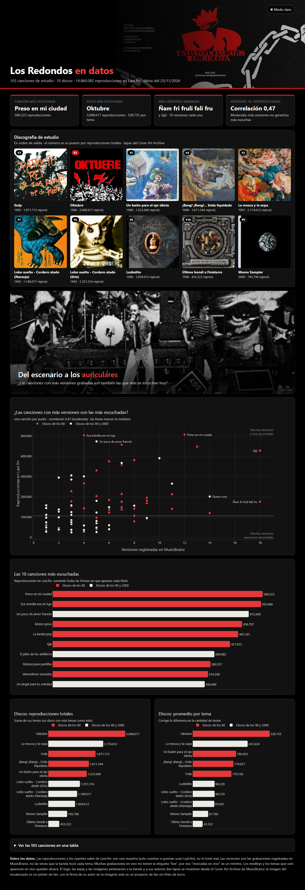
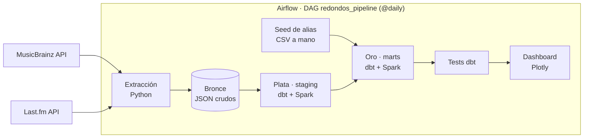

# Los Redondos en datos

Pipeline de datos de punta a punta sobre la discografía de **Patricio Rey y sus
Redonditos de Ricota**: baja datos de dos APIs públicas, los limpia y modela en
tres capas con dbt sobre Spark, lo orquesta con Airflow y publica un dashboard.

Es un proyecto personal para practicar ingeniería de datos con un tema que me
gusta.



## La pregunta

> ¿Cuáles son las canciones y discos más escuchados de los Redondos, y las
> canciones con más versiones grabadas (estudio y vivo) son también las más
> escuchadas?

**Respuesta corta** (datos de Last.fm y MusicBrainz del 25/11/2026):

- La canción más escuchada es **Preso en mi ciudad** (506.523 reproducciones),
  muy cerca de **Esa estrella era mi lujo** (502.686).
- El disco más escuchado es **Oktubre** (1986), tanto en total (3.048.617) como
  en promedio por tema (338.735). El último es *Último bondi a Finisterre*.
- **Más versiones no garantiza más escuchas.** La correlación entre versiones
  grabadas y reproducciones es **0,47** (moderada). *Jijiji* y *Ñam fri fruli
  fali fru* son las que más versiones tienen (18 cada una), pero *Esa estrella
  era mi lujo* es la segunda más escuchada con solo 4.

## Arquitectura



| Capa | Qué tiene | Dónde |
|---|---|---|
| **Bronce** | Las respuestas de las APIs tal cual llegan, en JSON, con la fecha de extracción en el nombre y adentro del archivo. | `data/raw/` |
| **Plata** (`staging`) | Una fila por canción, grabación o tema, con los títulos normalizados y los tipos corregidos. Sin cruzar fuentes. | `models/staging/` |
| **Oro** (`marts`) | Modelo dimensional: `dim_disco`, `dim_cancion`, `fct_grabacion` y `fct_popularidad`. | `models/marts/` |

**El DAG** (`airflow/dags/redondos_pipeline.py`):

```
extraer_mb_recordings >> extraer_mb_discos_estudio ┐
                                                   ├> dbt_seed >> dbt_run >> dbt_test >> dbt_docs_gen >> generar_dashboard
extraer_lastfm ────────────────────────────────────┘
```

- Las dos tareas de MusicBrainz van en fila porque la API permite una consulta
  por segundo. Last.fm es otra API y corre en paralelo.
- Corre todos los días. `fct_popularidad` guarda una foto por día, así que con
  el tiempo se puede ver la evolución de las reproducciones.

**Herramientas:** Python, Apache Airflow 3, dbt, Apache Spark 4 con Iceberg,
Plotly, Docker y ruff.

## Fuentes de datos

| Fuente | Qué aporta | Volumen |
|---|---|---|
| [MusicBrainz](https://musicbrainz.org/doc/MusicBrainz_API) | Catálogo: los 10 discos de estudio con sus temas, y todas las grabaciones registradas del artista. | 10 discos, 103 temas, 696 grabaciones |
| [Last.fm](https://www.last.fm/api) | Popularidad: reproducciones y oyentes de cada canción (`artist.getTopTracks`). | 9.741 entradas |

**El alcance son las 103 canciones de los 10 discos de estudio** (*Lobo suelto -
Cordero atado* son dos discos). Las versiones en vivo de esas canciones sí
cuentan. Los temas que solo aparecen en vivo o en demos quedan afuera.

## Calidad de datos: lo que hubo que limpiar

Cruzar las dos fuentes por título fue lo más trabajoso del proyecto. Last.fm no
tiene un identificador confiable por canción, así que el cruce se hace por
**título normalizado**: minúsculas, sin tildes, sin marcas de versión entre
paréntesis, sin puntuación y sin espacios de más (macro
[`normalizar_titulo`](airflow/redondos_analytics/macros/normalizar_titulo.sql)).
Después, un **seed de alias** hecho a mano (215 filas) lleva cada variante a su
nombre canónico, que es el título tal como figura en el disco de estudio.

Algunos casos que aparecieron en el camino:

- **85 formas de escribir una canción.** Last.fm tiene 85 entradas distintas
  para *¡Lobo ¿estás?!*: `¡Lobo ¿estás?!`, `Lobo ¿Estas?`, `LOBO ESTAS`,
  `Lobo, estas-`, `!Lobo ¿Estas-!`… La principal tiene 45.153 reproducciones y
  el resto se reparte entre variantes. 102 de las 103 canciones aparecen con más
  de un nombre.
- **Sumar sí, contar dos veces no.** *Soga de Caín* tenía 5 entradas en la
  extracción del 23/11/2026: 24.786 + 6.389 + 303 + 1 + 1 = **31.480
  reproducciones**. Dos de esas entradas eran `''Soga de Cain''` y
  `Soga De Caín   `, con espacios al final. Las reproducciones se suman, porque
  cada una es una escucha. Los oyentes no: alguien que tiene la canción cargada
  con dos nombres se contaría dos veces. Por eso se toman los oyentes de la
  entrada principal (6.270, no 7.924).
- **Tildes que parecen iguales y no lo son.** Una "ó" puede ser un carácter, o
  una "o" seguida de una tilde suelta (U+0301). Hay que limpiar las dos formas.
- **Caracteres invisibles.** Un *Invocación* empezaba con un carácter de ancho
  cero (U+200C): se ve igual, pero no cruzaba con nada.
- **Letras equivocadas y texto roto.** `Cańa seca y un membrillo` (con ń en vez
  de ñ), títulos con la codificación rota (`Canción`) y títulos en cirílico.
  Los que no se pueden recuperar quedan afuera solos, porque no cruzan con
  ningún alias.
- **Mismo título no es mismo disco.** *Lobo suelto - Cordero atado* aparece dos
  veces en MusicBrainz y no es un duplicado: son dos discos distintos (Naranja,
  12 temas, y Gris, 13). El criterio de repetido es título **y** desambiguación.
- **Una etiqueta que falta.** Solo 87 de las 511 grabaciones de las canciones de
  estudio están marcadas como `live`, aunque muchas más son en vivo. Por eso no
  se separan estudio y vivo: se cuenta el total de grabaciones, y "marcadas en
  vivo" se muestra como un mínimo.

**Cómo se controla:** la limpieza en SQL se comparó contra la versión de
Python sobre los 9.741 títulos, y las 62 diferencias son todas basura que no
cruza con ningún alias. Además de los tests `unique`, `not_null` y
`relationships`, hay un test propio,
[`toda_cancion_tiene_popularidad`](airflow/redondos_analytics/tests/toda_cancion_tiene_popularidad.sql),
que falla si una canción de estudio se queda sin datos de Last.fm. Por ejemplo,
si Last.fm cambia un título y el seed no lo reconoce, el pipeline avisa en vez
de mostrar un número incompleto.

## Limitaciones: qué es muestra y qué es estimación

- **Las reproducciones son una muestra.** Last.fm solo cuenta a sus usuarios
  que registran lo que escuchan. No es el total real de escuchas de la banda.
- **Los oyentes son un piso.** Se toma la entrada principal de cada canción, así
  que quien la escuchó solo con otro nombre no se cuenta.
- **Versiones registradas no es veces tocada en vivo.** Es la cantidad de
  grabaciones que alguien cargó en MusicBrainz, que es una base colaborativa.
- **"Marcadas en vivo" es un mínimo**, porque falta la etiqueta en muchas
  grabaciones.
- **Quedan afuera:** los medleys (aunque estén formados por canciones de
  estudio) y las canciones que no están en ningún disco de estudio.
- **Épocas:** el dashboard agrupa los discos en "80" y "90 y 2000". *Momo
  Sampler* (2000) es un solo disco y va con los 90.

## Cómo correrlo

Requisitos: Docker Desktop y una clave gratuita de la
[API de Last.fm](https://www.last.fm/api/account/create).

1. Copiar `.env.example` como `.env` y completar `LASTFM_API_KEY`. El `.env`
   está en `.gitignore` y no se sube.
2. Levantar el entorno. La primera vez tarda, porque descarga Spark y Airflow:
   ```bash
   docker compose up -d --build
   ```
   Usa los puertos 8080, 8888, 4040 y 8081.
3. Entrar a Airflow en http://localhost:8080, activar el DAG
   `redondos_pipeline` y correrlo con ▶. Tarda unos 8 minutos, casi todos
   esperando a MusicBrainz.
4. Abrir `airflow/redondos_analytics/dashboard.html` en el navegador. Hace
   falta internet para cargar Plotly y las tapas de los discos.

Para explorar las tablas, Jupyter está en http://localhost:8888 con Spark
listo. Por ejemplo, en una celda:

```sql
%%sql
select * from redondos_db.dim_cancion
```

## Estructura

```
.
├── airflow/
│   ├── dags/
│   │   ├── redondos_pipeline.py      # el DAG
│   │   └── extraccion/               # extractores de MusicBrainz y Last.fm
│   └── redondos_analytics/           # proyecto dbt
│       ├── macros/                   # normalizar_titulo, registrar_fuentes_crudas
│       ├── models/staging/           # capa plata
│       ├── models/marts/             # capa oro
│       ├── seeds/alias_canciones.csv # alias de títulos, hecho a mano
│       ├── tests/                    # tests propios
│       ├── dashboard.py              # genera dashboard.html
│       └── assets/                   # imágenes del dashboard
├── data/raw/                         # capa bronce (no se sube a git)
├── docs/                             # captura del dashboard
├── notebooks/                        # limpieza.py: versión Python de referencia
├── Dockerfile
└── docker-compose.yml
```

## Imágenes y créditos

El logo, las tapas y las imágenes pertenecen a la banda y a sus autores. Las
tapas se cargan desde el [Cover Art Archive](https://coverartarchive.org/) de
MusicBrainz y no se guardan en el repo. La imagen del encabezado es un póster
de fan, con la firma de su autor en la imagen. Este es un proyecto de fan, sin
fines de lucro. Si sos autor de alguna imagen y querés que se saque, abrí un
issue.

No se incluyen letras de canciones.
